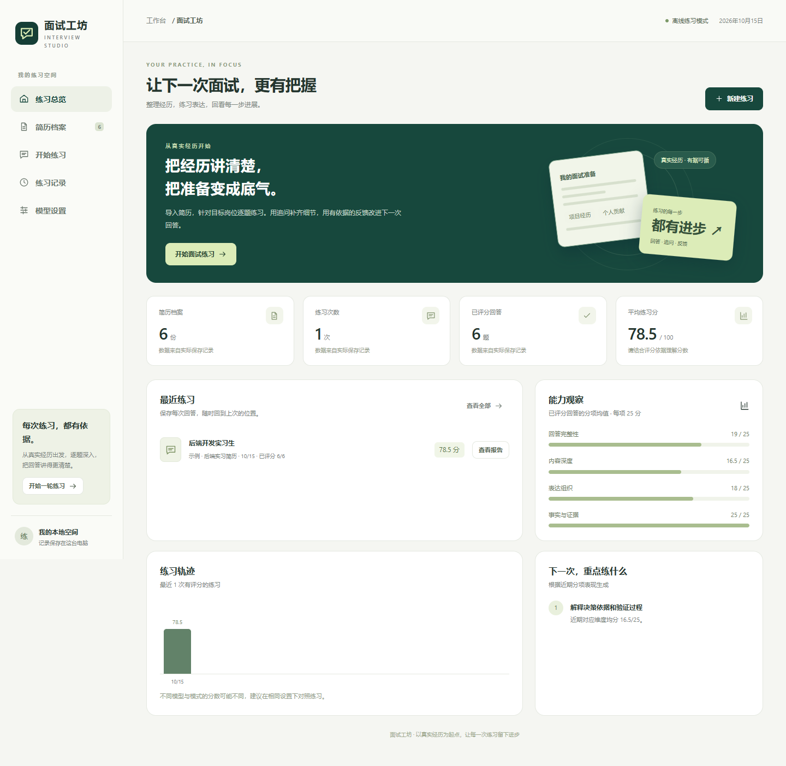

# 面试工坊 · Interview Studio

面向本科生求职与保研的 AI 面试练习 Web 应用。导入简历、生成个性化题目、逐题追问、评分取证、事实整理、重练与导出形成闭环。

**2.0.1 可靠性修订版**。队伍：AAAI简历模拟训练；重庆邮电大学，A组；成员宋佳钊，计算机科学与技术本科。指导老师待本人确认，团队信息正式提交前复核。推荐方向：AI教育与学习平台。



## 快速运行（Windows）

安装 Python 3.12、Node.js 24 LTS 和 Git：

```powershell
git clone --branch codex/competition-upgrade https://github.com/shurkasajini538-ux/ai-interview-agent.git
cd ai-interview-agent
```

双击 **安装依赖.cmd** 安装锁定依赖并构建 React 前端，再双击 **启动面试工坊.cmd**，访问 http://127.0.0.1:8765 。无需 Key 即可离线练习。**停止面试工坊.cmd** 关闭本应用；升级已运行版本时先停止再启动。

手工安装与运行：

```powershell
py -3.12 -m venv .venv
.venv/Scripts/python.exe -m pip install -r requirements.lock.txt
npm.cmd --prefix frontend ci
npm.cmd --prefix frontend run build
.venv/Scripts/python.exe app.py --open
```

首次安装需要网络；构建后离线练习无需联网。Node 只用于构建或开发，运行由 Python 提供静态文件与 API。前端开发：先启动后端，再运行 `npm.cmd --prefix frontend run dev`。

## 使用流程与能力

1. 在「简历档案」导入 DOCX、PDF、图片、TXT 或 Markdown，核对并修改解析结果。
2. 选择简历、目标岗位、题数和岗位描述，生成固定题目。
3. 回答与追问后查看四项评分、原文证据、STAR 整理，可重答并保留旧尝试。
4. 完成后导出 Markdown / JSON，或打印保存 PDF；历史弱项用于下一轮训练。

图片和扫描 PDF 在本机 OCR；批量最多5份、单文件12MB、PDF最多30页且扫描页最多6页。旧 `.doc` 请转 `.docx`。Word 内嵌图片应单独导入，复杂双栏与数字须人工核对。

## AI 实现

- 真实 Function Calling：两轮决策、最多四次工具调用，支持 search_resume、read_weak_points、record_fact_gap，参数校验后执行并显示记录。
- 来源分块与检索：1536维哈希 TF-IDF 稀疏向量 + 关键词检索，以 RRF 融合。保留来源 ID 和字符位置；它不是神经语义向量。
- 事实校验：四项各0–25分，总分由服务端求和；证据检查原文，STAR只接受回答的连续原文片段，未知事实标记待补。
- 后台任务与 SSE：显示阶段、工具事件及生成文字；验证后落盘；协作式取消防止取消后写入，不能保证立即中止已发送的供应商请求或撤回费用。
- SQLite、固定快照、请求去重、重答历史与草稿恢复。未完成任务事件在服务重启后失效，已保存练习可继续。

## 模型配置

在「模型设置」填写兼容 Chat Completions 的接口地址、模型和 Key。模型需支持 tools 和 SSE 才启用对应选项，不支持时可关闭。在线模式向所选服务发送相关简历、岗位和回答，默认遮盖常见联系方式；失败时明确标注离线回退。不同引擎的分数不能直接比较。

复制 `.env.example` 为 `.env`：**进程环境变量 > .env > 界面保存配置 > 默认值**。

| 变量 | 作用 |
|---|---|
| LLM_MODE | local / online，示例默认 local |
| LLM_API_KEY | 仅服务端读取，环境 Key 不复制到保存配置 |
| LLM_BASE_URL / LLM_MODEL | 接口基础地址与模型名 |
| LLM_REDACT_CONTACTS | 默认 true，遮盖常见联系方式 |
| STUDIO_AGENT_ENABLED | 默认 true，受控工具决策 |
| STUDIO_STREAM_ENABLED | 默认 true，模型流式输出 |

Windows 保存的 Key 使用当前账户 DPAPI，跨账户需重新填写；非 Windows 是权限受限文件内的 Base64 编码，并非加密，建议使用进程环境变量。运行数据在 data/，备份前停止服务；密钥及用户数据不入库。

## 架构与目录

React / TypeScript / Zustand → 本机 API 与后台任务 → 解析和 OCR → 证据索引与受控工具 → 模型 → 结果校验 → SQLite → 报告。

| 路径 | 职责 |
|---|---|
| frontend/ | 六个懒加载页面、组件、类型和状态 |
| app.py | 本机 API、静态文件和流程入口 |
| studio/agent.py / knowledge.py | 受控工具与证据索引 |
| studio/models.py / runtime.py / jobs.py | 模型传输、用量、取消和事件 |
| studio/interview.py / storage.py | 面试校验、持久化与隔离 |
| studio/resumes.py | 文档解析和本地 OCR |
| tests/ / verification/ | 自制样本、自动测试与实测记录 |
| docs/ / tools/ | 技术材料、计划与可复现实验 |
| web/ | 未构建时的旧版兼容入口，参赛请构建新版 |

## 验证

38项后端测试、16组浏览器验收通过，覆盖导入、完整六题、刷新、重答、导出、390px布局和浏览器空间隔离。真实模型记录见 verification/live-model-v2-results.json：出题和评分各调用3次工具，共8次模型请求、7018输入Token、2213输出Token、约35.3秒；仅为一轮工程验证。

12条自制查询中，旧字符匹配、关键词、稀疏向量及融合检索的 Hit@1 / Hit@3 均100%。小样本未显示方法差异，不能宣称提升；暂无真实教学效果研究。

```powershell
.venv/Scripts/python.exe -m unittest discover -s tests -v
.venv/Scripts/python.exe tools/evaluate_retrieval.py
npm.cmd --prefix frontend run build
# 独立终端启动隔离验收服务：
.venv/Scripts/python.exe tests/run_browser_server.py
# 另一个终端运行浏览器验收（Windows使用Edge）：
node tests/browser_acceptance.cjs
```

## 边界与来源

面向本机个人使用，默认仅绑定127.0.0.1。Cookie空间隔离不等于公网身份认证，不能直接暴露到互联网。评分用于练习参考；清除Cookie会失去原空间入口。运行数据和证据索引保留本地，暂不提供账户级一键清除界面。

延续本仓库原面试项目，借鉴 [WhiteNight123/parser-resume](https://github.com/WhiteNight123/parser-resume) 的多格式入口、结构展示与材料组织，其代码、权重、私人简历和凭证未并入产品。见 docs/来源与取舍.md 与 docs/依赖与来源.md。开发使用AI辅助，参赛成员仍须理解并对内容负责。

参赛计划见 docs/参赛成品工作计划.md。正式提交由本人核实队伍、指导老师、报名审核、截止时间与最终材料。

## 2026-10-15 修订

2.0.1修复无匹配检索误返回、索引缓存重复计算/并发写入、后台任务全局容量与浏览器存储受限导致的任务中断。详见[修订记录](docs/2.0.1修订记录.md)。output/和桌面2026-10-14候选包保留2.0.0材料，本次代码修订未冒充已重新录制全部材料。
